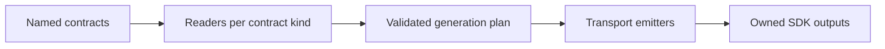

# Canon code generation discussion

Status: discussion draft. The current package and public namespaces are defined
in [Canon architecture and public API](canon.md). The commands, configuration and
combined SDK sketches below are candidates for review with the maintainer before
implementation. They are not implemented APIs.

## One library and generated consumer code

There is one library distribution: `fastapi-canon`. Its optional integrations
live under `fastapi_canon.integrations`; `[codegen]` selects tooling dependencies
inside that same library. This design does not add a separate generator package
or restore any predecessor distribution.

Generated client files belong to consumer applications. Discussing their output
layout is a later question about generated artifacts, not about splitting Canon
into multiple installable libraries. No generated SDK publication is proposed by
this draft. The output layout remains undecided until discussed separately.

## Starting point

Canon 0.9.0 source already contains one distribution, one version, feature extras
and one `canon` executable. The implemented generator families are `canon sse`,
`canon websockets` and `canon webrtc`. Their exporters and emitters preserve the
existing contracts, configuration formats, runtime options and ownership manifests.

| Capability | Python | TypeScript | Contract |
| --- | --- | --- | --- |
| Typed SSE | Supported | Supported | OpenAPI 3.2 with SSE metadata |
| WebSocket RPC and subscriptions | Supported | Supported | OpenRPC with protocol metadata |
| Typed JSON sockets, raw sockets and binary streams | Supported | Supported | OpenRPC with socket/stream metadata |
| WebRTC sessions and data channels | No existing emitter | Supported | WebRTC session contract |
| Ordinary REST | Separate OpenAPI tooling | Separate OpenAPI tooling | OpenAPI |

The SSE generator emits stream operations and reachable models, not the entire
REST API. Raw socket bindings describe their declared protocol; a WebSocket URL
alone does not establish typed messages. Python and TypeScript also have different
runtime validation guarantees. A common workflow must preserve these distinctions.

## Canon constraints

The package architecture supplies the following constraints:

- Keep codegen inside `fastapi-canon`; generator dependencies use `[codegen]`.
- Keep OpenAPI, OpenRPC and the WebRTC contract as reviewable input artifacts.
- Preserve wire behavior, including JSON-RPC 2.0 and `fastapi-webrtc.v1`.
- Keep generation dependencies separate from generated SDK runtime dependencies.
- Retain custom transport/binding options, Python HTTP backends and SSE diagnostics.
- Keep one owner per generated output directory and preserve handwritten files.
- Make unsupported requested targets explicit, including WebRTC for Python.

These constraints do not decide the SDK layout, shared type representation or
configuration syntax. The following sections propose a consistent shape.

## Vocabulary

| Term | Meaning |
| --- | --- |
| Contract | A saved protocol description or an explicitly configured live export |
| Contract kind | The document format: `openapi`, `openrpc` or `webrtc` |
| Transport | The feature emitted from a contract: `sse`, `websockets` or `webrtc` |
| Target | A named generation job with a language, contracts, options and output |
| SDK | The generated package consumed by an application |
| Model identity | An explicit semantic identity, including input/output direction |

Use transport names at public boundaries. RPC stays a protocol within the
`websockets` transport. An OpenAPI contract may contain HTTP and SSE operations;
selecting SSE generation does not select an ordinary REST emitter.

## Candidate workflow

A proposed common command is:

```console
uv run canon generate
uv run canon generate --check --diff
uv run canon generate --target frontend
```

Individual stages could remain available:

| Candidate command | Behavior |
| --- | --- |
| `canon contracts export` | Export configured live sources and validate supplied inputs |
| `canon contracts export --check` | Check contract drift without writing |
| `canon clients generate` | Generate from saved contracts without resolving application export sources |
| `canon clients generate --check` | Check SDK drift against saved contracts |

The full workflow should use current exports for both contract comparison and
client generation. Checking clients against a stale saved contract can otherwise
miss application drift. Render and validate the selected plan before changing files.
Check mode should not create files, manifests or diagnostic reports.

A consistent candidate exit-code policy is `0` for success, `1` for drift and `2`
for configuration, dependency or contract errors. Errors should take precedence
over drift. `--diff` would require `--check`; target selection would be repeatable.
No command should install dependencies automatically.

## Candidate configuration

A single versioned `[tool.canon]` table could name contracts and targets. This
example describes a possible combined TypeScript SDK; it is not current config.

```toml
[tool.canon]
config-version = 1

[tool.canon.contracts.http]
kind = "openapi"
source = "app.main:app"
output = "contracts/openapi.json"

[tool.canon.contracts.websockets]
kind = "openrpc"
source = "app.contracts:websocket_contract"
output = "contracts/websockets.openrpc.json"

[tool.canon.contracts.webrtc]
kind = "webrtc"
source = "app.main:app"
output = "contracts/webrtc.json"

[tool.canon.clients.frontend]
language = "typescript"
contracts = ["http", "websockets", "webrtc"]
transports = ["sse", "websockets", "webrtc"]
output = "frontend/src/generated"
client-name = "ApiClient"
```

A saved external contract could use `input = "contracts/supplied.json"` instead
of `source` and `output`. WebSocket live sources should remain explicit
`RpcContract` exports. Paths and import roots should resolve relative to the
selected configuration file. Transport options should remain scoped, such as
`options.sse.http-client`, rather than creating unrelated global flags.

Unknown keys, ambiguous contract selection, overlapping outputs and unsupported
language options should fail before writes. Saved-contract generation should not
require the application or media engines. Explicit generation plugins and
bindings remain an application choice.

## SDK layout to decide

| Candidate | Benefit | Cost |
| --- | --- | --- |
| One SDK per language, with transport submodules | One consumer package and a place for shared configuration and verified shared models | Requires a deliberate generated API, lifecycle rules and one output owner |
| Separate transport SDKs driven by one configuration | Reuses current emitters and consumer APIs with little adaptation | Consumers still coordinate several generated entry points and model definitions |

One possible target is one SDK per language with transport submodules. It
could reuse the existing emitters first and add a shared type layer only for
concrete reuse. This is a consumer-output option, not an agreed package change. A possible consumer shape is:

```typescript
const client = new ApiClient({ baseUrl });
client.sse.runs.events(...);
client.websockets.rpc.tasks.create(...);
client.websockets.sockets.telemetry.connect(...);
client.webrtc.practice.connect(...);
```

This is a schematic API, not a compilable example. Constructing it should not
connect every transport. Connection ownership and cleanup must remain explicit.
A common base URL or credential provider cannot hide transport limitations:
browser WebSockets cannot attach arbitrary HTTP request headers.

## Models, diagnostics and ownership

A common type registry should reuse only definitions with compatible semantic
identity and serialization direction. Matching class names or JSON shapes alone
are insufficient. Inputs and outputs may differ in aliases, defaults or required
fields. External contracts may need explicit bindings. Conflicts should identify
both source locations instead of silently widening types to `Any` or `unknown`.

A suggested pipeline is:



A combined target needs one writer and a deterministic manifest, provisionally
`.canon-codegen.json`. It should record contract hashes, generator/configuration
versions, options, generated files and SDK runtime requirements. It should reject
unsafe paths and collisions and remove only previously owned stale files.
Existing ownership manifests need an explicit migration if their writer changes.

## Decisions for the next discussion

1. Choose the consumer result: a combined SDK with transport submodules, or
   separate SDKs under one generation workflow.
2. Agree whether one `ApiClient` facade is useful and how it receives transport
   configuration, credentials and lifecycle ownership.
3. Choose stable model identity and input/output rules before sharing types.
4. Review the configuration and command names, including offline generation,
   target selection and the migration of existing generator options.
5. Agree an implementation sequence and acceptance checks. A common runner can
   precede a combined SDK and shared types without claiming those steps are done.

Ordinary REST generation is a separate possible extension. The next codegen
implementation should follow the agreed decisions; the draft itself does not
authorize replacing the existing generators or generated client APIs.
