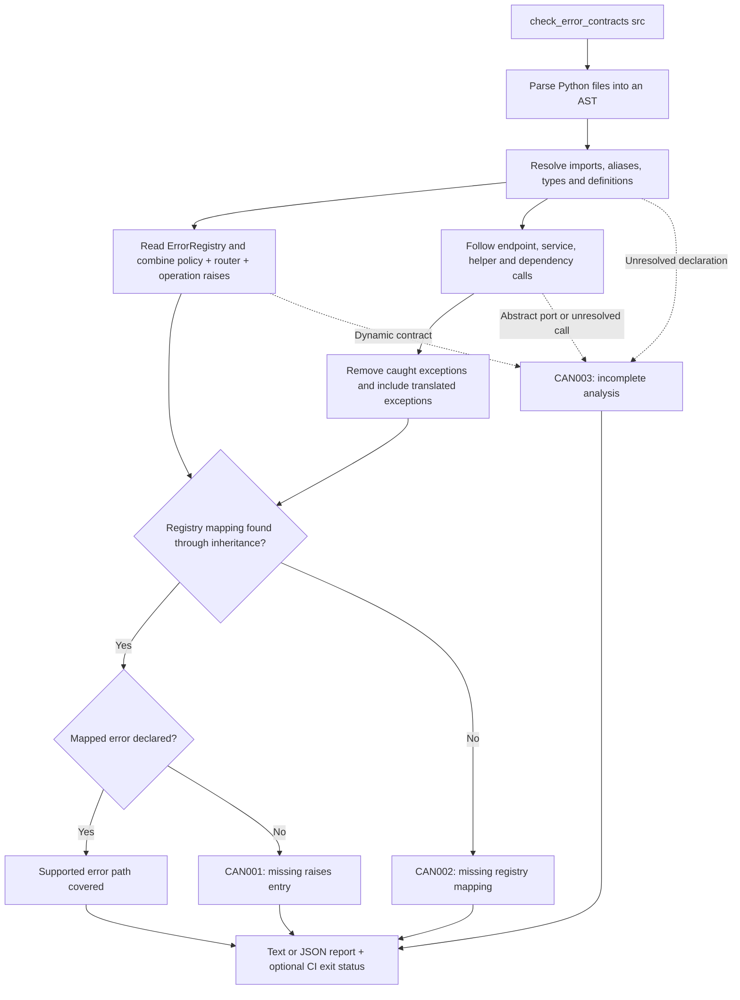

# Optional error-contract checking

Run the source checker to find application exceptions missing from a direct
`CanonRouter` operation's `raises=` declaration:

```console
python -m fastapi_canon.check_error_contracts src
```

Pass Python import roots: for `src/app/features/...`, use `src`, not `src/app`.
Multiple roots are accepted when they contain different modules. In this
workspace, run:

```console
uv run --locked python -m fastapi_canon.check_error_contracts examples/reference-service/src --strict
```

The checker is included in Canon and needs no extra dependencies or annotations
on application services. It parses source without importing the inspected
application, constructing a Dishka container, or opening application resources.
It is optional development tooling; normal route registration, runtime exception
mapping and OpenAPI validation keep their existing behavior.

## How the check works

The checker compares two sets for each operation: application exceptions escaping
the supported source paths, and errors declared by that operation and its router.
It reads both from source; it does not execute the application.



For example, `complete_task` calls `TaskService.complete`, which can explicitly
raise `TaskNotFound`. The checker finds its `task_not_found` registry mapping and
looks for that exact error in the operation's combined `raises`. Removing the
declaration produces `CAN001` with the call path. If the same service calls an
abstract repository method, that call also produces `CAN003`: a known gap and an
incomplete analysis can appear together.

The command is the supported entry point. The `_checks` modules, their types and
constants, and the report objects are private implementation details;
the documented JSON fields are the machine-readable interface.

## Findings and CI

Given a service method that raises `TaskNotFound`, an endpoint calling that method
must declare its mapped `task_not_found` error, either locally or on its router.
The checker reports the source location and resolved call path when it is missing:

```text
service.py:24: CAN001 [app.router.complete_task] app.service.TaskNotFound: app.errors.task_not_found is missing from raises
  app.router.complete_task -> app.service.TaskService.complete
```

| Code | Meaning |
| --- | --- |
| `CAN001` | An explicit application exception has a registry mapping that is missing from the operation's combined `raises`. |
| `CAN002` | An explicit application exception has no mapping in that router's registry. |
| `CAN003` | A declaration or execution path could not be fully analyzed. |

Default mode prints findings and exits zero. Use `--strict` to exit one for
contract gaps. Incomplete analysis remains visible and does not fail this mode.
Add `--require-complete` to fail for incomplete operations or a scan containing no
supported operations. Use both flags when both conditions should fail CI:

```console
python -m fastapi_canon.check_error_contracts src --strict --require-complete
python -m fastapi_canon.check_error_contracts src --strict --format json
```

Invalid roots, duplicate module names, unreadable files and syntax errors exit
two. JSON output includes each operation's diagnostics, a `complete` flag,
`contract_gaps` and `incomplete_operations`. An operation can be fully analyzed
and still contain a contract gap. An empty result does not establish coverage.

When an error catalog or `raises` sequence cannot be resolved, the checker reports
incomplete analysis instead of guessing which errors are missing.

## Performance in CI

The checker reads each source file once and reuses function summaries and
inheritance results within that invocation. Summaries retain the first error path
per exception, matching the report's existing behavior. Cached summaries also
retain dependencies on modules with uncertain declarations; recursive call paths
remain incomplete. All caches are discarded when the check finishes, so each new
invocation reads the current source.

Local Windows/Python 3.14 measurements with dependencies installed and a warm
filesystem cache:

| Workload | Source processing | Full CLI invocation |
| --- | --- | --- |
| Reference service: 43 files, 4 operations | 18–39 ms | 1.0–1.9 s |
| Synthetic shared helper graph: 102 files, 1,000 operations | 0.26 s | 1.32 s |
| Synthetic shared helper graph: 1,002 files, 10,000 operations | 4.93 s | 6.63 s |

The 1,000-operation case improved from 7.70 s to 1.32 s for the full command,
using five-run medians. Before/after reports have identical fingerprints,
including source locations, error paths and incomplete-analysis diagnostics.
The 10,000-operation case uses a three-run median. These synthetic workloads
exercise shared services and repeated helper calls; they are measurements, not CI
time limits or guarantees for other projects. Python and Canon's existing
FastAPI/Dishka imports account for most of a small project's command time.

Pass all relevant import roots in one invocation to pay interpreter startup once.
Measure on your CI runner before setting a time budget. From this workspace, use:

```console
uv run --locked python scripts/benchmark_error_contracts.py --output dist/checker-benchmark.json
```

The benchmark generates its workload under `dist/`, measures source processing
and fresh CLI processes separately, and records Python/platform metadata. Use
`--compare dist/previous-benchmark.json` to verify unchanged report fingerprints;
`--profile dist/checker.prof` records a cProfile capture. CI regression tests
verify that shared helpers are analyzed once and cached results preserve
completeness, rather than asserting machine-dependent wall-clock thresholds.

## Supported source patterns

The initial checker follows direct `CanonRouter` declarations with ordinary route
decorators, including `api_route`. It reads literal `ErrorRegistry(errors=[...])`
and named `Error` definitions. A direct, statically resolved `RouterPolicy` supplies
its registry, dependencies and shared errors. Policy, router and operation `raises`
combine; supported
sequences include named lists/tuples, unpacking and concatenation. Router contracts
do not propagate to separately included child routers.

Analysis follows imports, aliases and explicit re-exports within the supplied
roots; typed service methods, including `FromDishka[Service]`; direct helper
calls; simple constructor-injected `self` attributes; and annotated return values.
It also follows function dependencies declared with `Depends` or `Security`,
including `Annotated` aliases, nested dependencies and router/operation dependency
lists. Dependencies supplied later while mounting an application are outside this
source-declaration check.

Explicit `raise` statements propagate through supported function calls and simple
branches. `try`/`except` removes caught exceptions, preserves bare re-raises and
includes translated exceptions from handlers. Exception matching and registry
selection follow statically resolvable Python inheritance order, so a more
specific registered error takes precedence over a base mapping. Conditions are
not proved feasible: a finding describes a possible source path, not a guarantee
that a particular request reaches it.

## Analysis boundaries

`complete` describes analysis of the supported explicit source paths, not proof
that no other runtime exception can occur. The checker does not model implicit
interpreter errors, every Python protocol or implicit descriptor invocation,
framework internals, application startup, transactions or background tasks.
Explicit built-in exceptions are outside the application-error comparison.

Unresolved calls, abstract ports, external constructors, custom decorators,
recursive calls, dynamic contracts, nested route factories, deferred coroutine
execution and unsupported control flow produce `CAN003`. Loops, context managers,
comprehensions, `match` and `except*` are currently outside the supported flow
analysis. Reassigned module declarations and detected contract mutations also
prevent a complete result, including assignments with type annotations. Expanded
`ErrorRegistry(**config)` arguments are unresolved contracts: the checker reports
`CAN003` and suppresses guessed gaps for those operations. Dishka provider bindings
are not executed or inferred:
an abstract port remains incomplete even if the application always binds one
implementation.

Only source route declarations are inspected; the tool does not establish which
routers are actually mounted, follow `dependency_overrides`, or validate composed
registries from other features. Pass all relevant source roots, retain runtime
contract validation and test the application's intended error paths.

When the scanned source contains `Composition(router_policy=...)`, the checker
marks operations incomplete and suppresses guessed contract gaps: determining
which operations inherit that policy requires analyzing application mounting.

Plain FastAPI routers are skipped. Canon's SSE and WebRTC declarations are outside
this first version. Generator bodies are explicitly incomplete: failures after
response start need transport-specific error events or protocol handling, rather
than additional HTTP `raises` entries.
